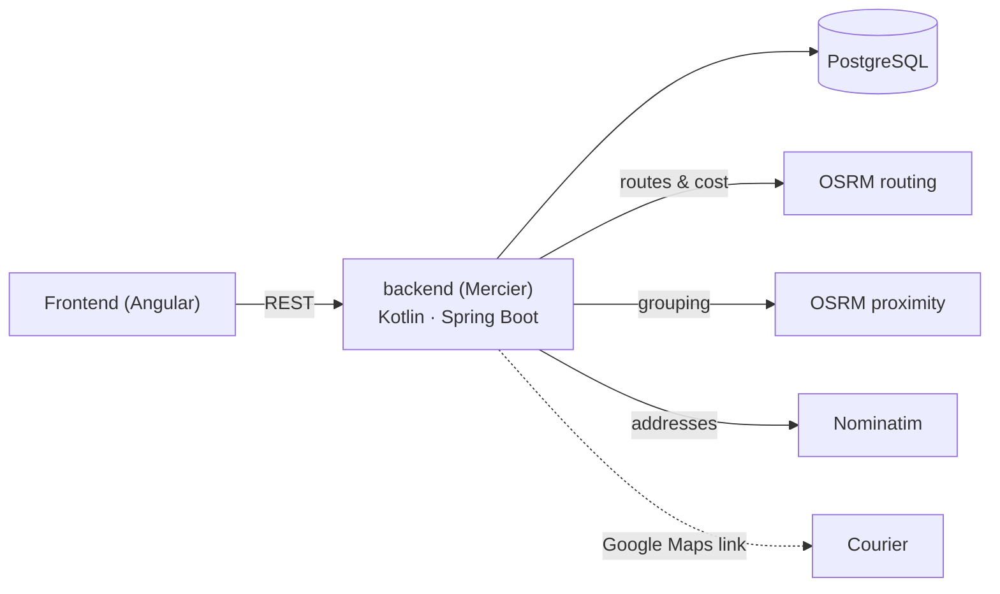

# shared-courier-pooling

Collaborative delivery for neighbourhood shops. When several nearby shops (a bakery, a greengrocer, a grocery store, a kiosk) have orders with compatible delivery windows, the system pools them into a single **round** for one courier, routes it over the real street network, and **splits the trip's cost** among the shops. Each shop pays less than a dedicated trip; the courier earns more per hour.

Final degree project (Universidad de Palermo). Not an open marketplace: a small, closed network of neighbouring shops and couriers they already work with. The system coordinates demand; it does not recruit couriers.

## How it works

1. A shop submits an order: destination address (geocoded and confirmed on a map) and delivery window.
2. **Grouping**: an order joins a round if its destination is within 500 m of every shop in the round (street-network distance, one-way streets ignored) and its window starts within 15 min of the others.
3. **Routing**: pickups at the shops, then deliveries, then back — each phase ordered by nearest neighbour over real driving distances (one-way streets respected), trying every shop as the starting point.
4. **Cost**: price per km × distance driven, split among the shops in proportion to their delivery stops. Each shop gets its cost and estimated delivery time; the courier gets the ordered stops and a Google Maps link.
5. Every new order re-plans all orders that have not left yet; a round is frozen when the courier departs.

**Case study** (4 shops on one block of Yerbal, Caballito, Buenos Aires; 5 orders between 19:00 and 19:30): one round of 3,734 m instead of 5 dedicated trips totalling 9,871 m — **62% cheaper** — with every delivery inside the window.



## Modules

| Folder | What | Docs |
|---|---|---|
| [`backend/`](backend) | **Mercier**: REST API, optimization engine, persistence | [README](backend/README.md) |
| [`osrm/`](osrm) | Self-hosted OSRM over an OpenStreetMap extract of Buenos Aires (two profiles) | [README](osrm/README.md) |
| [`nominatim/`](nominatim) | Self-hosted geocoder over the same extract | [README](nominatim/README.md) |
| [`frontend/`](frontend) | Mobile-first web app for shops and couriers | [README](frontend/README.md) |

## Tech stack

- **Backend**: Kotlin, Spring Boot 4, Spring Data JPA (Hibernate), Flyway, SLF4J/Logback.
- **Data**: PostgreSQL 17.
- **Routing**: [OSRM](https://project-osrm.org/) (car profile), self-hosted — no paid APIs, no straight-line distances.
- **Geocoding**: [Nominatim](https://nominatim.org/), self-hosted.
- **Map data**: [OpenStreetMap](https://www.openstreetmap.org/) via [Geofabrik](https://download.geofabrik.de/).
- **Tests**: JUnit 5, MockMvc, Testcontainers.
- **Infra**: Docker Compose.
- **Frontend**: Angular 22, Angular Material, Leaflet (OpenStreetMap tiles), Vitest.

## Getting started

### Whole system in Docker

Requirements: Docker (with Compose).

```bash
./osrm/prepare.sh                                # map data (~400 MB download, once)
docker compose --profile app up -d --build       # everything; Nominatim imports the map on its first start (~7 min)
```

Open http://localhost:8081 (API docs: http://localhost:8081/swagger-ui.html). nginx serves the app and proxies the API, so the browser sees a single origin.

### Development

Requirements: Docker (with Compose), JDK 25 and Node.js 24. `docker compose up -d` (without the `app` profile) starts only the infrastructure.

```bash
# 1. Map data: download the Argentina extract, clip it to Buenos Aires, preprocess both OSRM profiles (~400 MB download)
./osrm/prepare.sh

# 2. Services: database, routing, geocoding (Nominatim imports the map on its first start, ~7 min)
docker compose up -d postgres osrm-routing osrm-proximity nominatim

# 3. Backend, with the case study shops preloaded
cd backend
./mvnw spring-boot:run -Dspring-boot.run.profiles=local
```

```bash
# 4. Frontend (in another terminal)
cd frontend
npm install
npm start
```

Open the app at http://localhost:4200 (API docs: http://localhost:8080/swagger-ui.html).

Tests:

```bash
(cd frontend && npm test)                # frontend unit tests
(cd backend && ./mvnw test)              # backend unit + API + persistence tests (needs Docker; no OSRM)
(cd backend && ./mvnw test -Pscenario)   # case study against the real OSRM services → backend/target/scenario-report.md
```

Optional route viewer for visual checks: `docker compose --profile tools up -d osrm-frontend` → http://localhost:9966

## Deployment

TODO: hosted environment (single VM running the same Docker Compose).

## License

[MIT](LICENSE)
